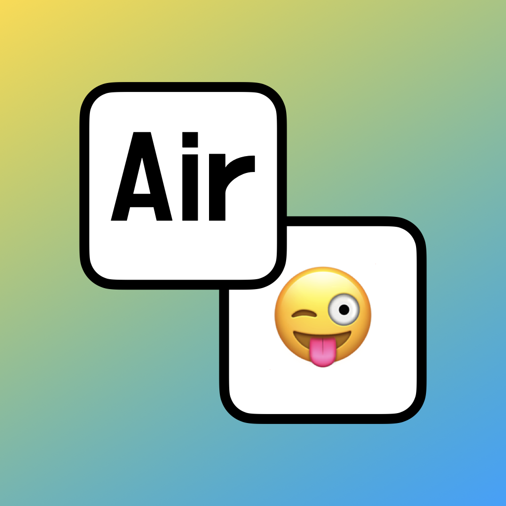

<p align="center">
  
</p>

# AirLingua

ローカル LLM を使った macOS 向け翻訳アプリ。右クリックメニューから即座に翻訳できます。

## 特徴

- **完全ローカル処理** - インターネット接続不要、プライバシー安全
- **右クリックで翻訳** - テキスト選択 → 右クリック → 「AirLingua: 日本語に翻訳」
- **メニューバー常駐** - 軽量でいつでもアクセス可能
- **複数モデル対応** - Gemma 4 / PLaMo 3 / Qwen3.5 / TranslateGemma / ELYZA / ALMA

## インストール

### Homebrew

```bash
brew tap fuwasegu/tap
brew install --cask airlingua
```

### 手動インストール

[Releases](https://github.com/fuwasegu/AirLingua/releases) から最新の ZIP をダウンロードして、`AirLingua.app` を `/Applications` に移動。

## 必要条件

- macOS 14.0 (Sonoma) 以上
- llama.cpp は同梱済み（別途インストール不要）

## 使い方

1. アプリを起動（メニューバーに常駐）
2. 設定からモデルをダウンロード
3. テキストを選択して右クリック →「サービス」→「AirLingua: 日本語に翻訳」

## 対応モデル

| モデル | サイズ | ライセンス | 備考 |
|--------|--------|------------|------|
| **PLaMo-3-translate 8B** | ~5.3 GB | PLaMo Community | **推奨（個人利用）** - PFN製 翻訳特化（最高品質・53言語） |
| **Gemma 4 E4B** | ~5.0 GB | Apache 2.0 | **推奨（商用可）** - Google製 高性能汎用、140言語以上 |
| **PLaMo-3-translate 2B** | ~1.8 GB | PLaMo Community | PFN製 翻訳特化（軽量・高コスパ）、個人利用のみ |
| **PLaMo-3-translate 0.8B** | ~0.6 GB | PLaMo Community | **推奨（超軽量）** - PFN製 翻訳特化（0.6GBで驚異の品質）、個人利用のみ |
| Qwen3.5-9B | ~5.9 GB | Apache 2.0 | 高品質 |
| Qwen3.5-4B | ~2.9 GB | Apache 2.0 | バランス |
| Qwen3.5-2B | ~1.3 GB | Apache 2.0 | 軽量 |
| Qwen3.5-0.8B | ~0.6 GB | Apache 2.0 | 超軽量 |
| TranslateGemma-4B | ~2.5 GB | Gemma License | Google製 翻訳特化、55言語対応 |
| PLaMo-2-translate | ~4.6-5.5 GB | PLaMo Community | Legacy（個人利用のみ） |
| Qwen3-8B | ~5.0 GB | Apache 2.0 | Legacy |
| Qwen3-4B | ~2.5 GB | Apache 2.0 | Legacy |
| ELYZA-JP-8B | ~4.9 GB | Llama 3 | Legacy |
| ALMA-7B-Ja | ~4.1 GB | MIT | Legacy |

## 翻訳品質比較レポート (2026-04-12 更新)

PLaMo 3 Translate（8B / 2B / 0.8B）および Gemma 4 E4B を含む主要モデルの英日翻訳品質を比較した。

### テスト条件

- **量子化**: すべて Q4_K_M (GGUF)
- **比較モデル**:
  - PLaMo-3-translate 8B (~5.3 GB) / 2B (~1.8 GB) / 0.8B (~0.6 GB)
  - Gemma 4 E4B (~5.0 GB)
  - Qwen3.5-9B (~5.9 GB) / Qwen3.5-4B (~2.9 GB)
  - TranslateGemma-4B (~2.5 GB)
- **実行環境**: AirLingua（`llama.cpp`、`temp=0.1, repeat-penalty=1.1`）※Gemma 4 E4B は同等のプロンプト設定

### Text A: 技術文書

> The garbage collector runs concurrently with the application threads, pausing them only briefly during the marking phase. This approach minimizes latency spikes at the cost of slightly higher overall CPU usage, which is an acceptable trade-off for most real-time systems.

| モデル | 翻訳結果 | 評価 |
|--------|----------|------|
| **PLaMo-3-translate 8B** | ガベージコレクタはアプリケーションスレッドと並行して動作し、マーキングフェーズの間だけ短時間それらを停止させます。この手法は、全体のCPU使用率がわずかに上昇する代わりにレイテンシのスパイクを最小限に抑えるものであり、ほとんどのリアルタイムシステムにおいて許容可能なトレードオフと言えます。 | **S** - 専門用語の選定・「〜する代わりに〜を抑えるものであり」の論理構成ともに完璧 |
| **Gemma 4 E4B** | ガベージコレクタはアプリケーションスレッドと並行して実行され、マークフェーズの間だけ短時間停止させます。このアプローチは、全体的なCPU使用率がわずかに高くなるものの、レイテンシの急上昇を最小限に抑えるため、ほとんどのリアルタイムシステムにとって許容できるトレードオフです。 | **S** - 文構造の組み替えが上手く「ものの」の接続が自然 |
| **PLaMo-3-translate 0.8B** | ガベージコレクタはアプリケーションスレッドと並行して動作し、マーキングフェーズ中のみ短時間だけそれらを一時停止します。この手法は、全体的なCPU使用率をわずかに高める代わりにレイテンシのスパイクを最小限に抑えることができ、ほとんどのリアルタイムシステムにおいて許容可能なトレードオフとなります。 | **A+** - 0.6 GB とは思えないほど自然で正確な技術文書訳 |
| **PLaMo-3-translate 2B** | ガベージコレクタはアプリケーションスレッドと並行して動作し、マーキングフェーズにおいてのみ短時間一時停止します。この手法は、全体的なCPU使用率がわずかに高くなる代わりにレイテンシのスパイクを最小限に抑えますが、ほとんどのリアルタイムシステムにとって許容可能なトレードオフです。 | **A** - 自然で正確だが後半の接続「抑えますが」の逆接がやや惜しい |
| TranslateGemma-4B | ガベージコレクタは、アプリケーションのスレッドと並行して動作し、マーキングフェーズ中にスレッドをわずかに一時停止するだけです。このアプローチにより、レイテンシの急激な増加を最小限に抑えることができますが、全体的なCPU使用量はわずかに高くなります。これは、ほとんどのリアルタイムシステムにとって受け入れられるトレードオフです。 | B+ - 正確だが3文に分割され冗長 |
| Qwen3.5-9B | ごみ収集プロセスはアプリケーションスレッドと並行して実行され、マークフェーズの間にのみ一時的にスレッドを停止します。このアプローチはレイテンシスパイクを最小限に抑える一方で、全体的な CPU 使用率がわずかに高くなるという代償がありますが、多くのリアルタイムシステムにとって許容可能なトレードオフです。 | B - 「ごみ収集プロセス」は技術文書では不適切 |
| Qwen3.5-4B | (中国語で出力) | **F** - 日本語翻訳タスクとして破綻 |

### Text B: 口語表現

> I mean, it's not like I don't get where they're coming from, but at the end of the day, you can't just ship something half-baked and call it a day. That's not how any of this works.

| モデル | 翻訳結果 | 評価 |
|--------|----------|------|
| **PLaMo-3-translate 8B** | まあ、相手の言い分が分からないわけじゃないけど、結局のところ、中途半端なものを出してそれで済ませるなんて無理だろ。そういう仕組みじゃないんだよ。 | **S** - 二重否定・イディオム（`where they're coming from`, `half-baked`, `call it a day`）・口語トーンすべて完璧 |
| **PLaMo-3-translate 0.8B** | まあ、彼らの言い分が分からないわけじゃないけど、結局のところ、中途半端なものを出してそれで終わりというわけにはいかない。そういう仕組みじゃないんだから。 | **S-** - 0.8B ながら二重否定を正確に処理し、口語のニュアンスも極めて自然 |
| **PLaMo-3-translate 2B** | いや、言いたいことは分かるんだけど、結局のところ、中途半端なもんを適当に出してそれで済ませられるわけじゃない。そういう仕組みじゃないんだから。 | **A+** - 二重否定を肯定に丸めているが、「中途半端なもん」など口語としての自然さが抜群 |
| **Gemma 4 E4B** | つまり、彼らの考えが理解できないわけではないのですが、結局のところ、未完成なものを出してそれで終わりだなんてことはできません。この件はそういう仕組みではありませんから。 | **A** - 意味完璧。丁寧語で口語感はやや薄い |
| Qwen3.5-9B | つまり、彼らの気持ちも理解できるわけじゃないけど、結局のところ、未完成のものをリリースして「これで終わり」と言うのはあり得ない。そんなやり方は、この業界では通用しないんだから。 | B- - 口語感は良いが二重否定の処理ミスで**意味が逆** |
| Qwen3.5-4B | 言い換えれば、彼らの立場を理解することはできるが、結局のところ、未完成のものをそのまま提出して終わりにするのはできない。それがこの状況のあり方ではない。 | C+ - 硬すぎて口語に聞こえない |
| TranslateGemma-4B | つまり、彼らが何を言いたいのかは理解できるけど、結局のところ、粗悪なものをそのまま出して「これで終わり」とは言えない。そういうことは何も起こらない。 | C - 末尾「そういうことは何も起こらない」が**誤訳** |

### Text C: 抽象的・比喩的表現

> Privacy is not merely the absence of surveillance; it is the presence of autonomy — the quiet confidence that your thoughts remain your own until you choose otherwise.

| モデル | 翻訳結果 | 評価 |
|--------|----------|------|
| **PLaMo-3-translate 8B** | プライバシーとは、単に監視がないことではなく、自律性があること――自ら別の選択をしない限り、自分の考えは自分だけのものであるという静かな確信のことである。 | **S** - 対比構造とダッシュの展開が一文で格調高くまとまり、代名詞の過剰訳もない |
| **Gemma 4 E4B** | プライバシーとは単なる監視の不在ではなく、自律性の存在です。それは、あなたが望むまで自分の考えは自分のものであるという静かな確信を意味します。 | **S** - 「あなたが望むまで」の意訳が秀逸 |
| **PLaMo-3-translate 2B** | プライバシーとは、単に監視がないことではなく、自律性があること――つまり、自ら別の選択をしない限り、思考は自分自身のものであり続けるという静かな確信のことである。 | **A+** - 8B とほぼ同等の格調高い訳出。「あり続ける」のニュアンスも的確 |
| **PLaMo-3-translate 0.8B** | プライバシーとは、単に監視がないことではなく、自律性の存在――つまり、別の選択をするまで自分の考えは自分自身のものであるという、静かな確信のことである。 | **A** - 対句がわずかに非対称だが、0.6 GB としては驚くほど自然 |
| Qwen3.5-4B | プライバシーとは、単に監視の欠如ではなく、自律の存在です——あなたが別の選択をしない限り、あなたの思考があなたのものであるという静かな自信。 | B+ - 正確だが体言止めで着地が弱い |
| TranslateGemma-4B | プライバシーとは、単に監視がないことだけではありません。それは、自律性の存在です—つまり、あなたがそうするまで、あなたの思考があなたのものであるという静かな確信のことです。 | B - 「あなたがそうするまで」が曖昧 |
| Qwen3.5-9B | プライバシーは単なる監視の不在ではなく、自律性の存在です。あなたの思考が、あなたがそう選択するまで、あなたのものであるという静かな自信です。 | B- - 「あなたの」が3回でくどい |

### 総合結果

| 順位 | モデル | サイズ | Text A | Text B | Text C | 総評 |
|------|--------|-------|--------|--------|--------|------|
| **1** | **PLaMo-3-translate 8B** | 5.3 GB | **S** | **S** | **S** | 全カテゴリで最高評価。特に口語・イディオムと自然な日本語表現力が圧倒的 |
| **2** | **Gemma 4 E4B** | 5.0 GB | **S** | **A** | **S** | 汎用モデルながら文の再構成力が極めて高い。商用利用なら最有力 |
| **3** | **PLaMo-3-translate 0.8B** | **0.6 GB** | **A+** | **S-** | **A** | **驚異のコスパ**。わずか 0.6 GB で 6 GB 級の汎用モデルを凌駕し、高速・省メモリ |
| **4** | **PLaMo-3-translate 2B** | 1.8 GB | **A** | **A+** | **A+** | 軽量ながら口語・抽象表現ともに 8B に迫る高い完成度 |
| 5 | Qwen3.5-9B | 5.9 GB | B | B- | B- | 口語の雰囲気は良いが、二重否定ミスと訳語ムラ |
| 6 | TranslateGemma-4B | 2.5 GB | B+ | C | B | 翻訳特化のわりに口語で誤訳。技術文書は安定 |
| 7 | Qwen3.5-4B | 2.9 GB | F | C+ | B+ | Text A で中国語出力は致命的 |

**結論**:
- **品質最優先（個人利用）**: **PLaMo-3-translate 8B** が技術文書・口語・抽象表現のすべてで S 評価を獲得。英語特有の二重否定やイディオム（`where they're coming from`, `half-baked`, `call it a day`）、代名詞の省略まで含めて、最も「翻訳臭のない自然な日本語」を出力する。
- **速度・省メモリ最優先**: **PLaMo-3-translate 0.8B**（約 0.6 GB）が驚異的。約10倍のサイズがある Qwen3.5-9B（5.9 GB）を全テストで上回り、常駐翻訳アプリとしてのレスポンス速度と品質のバランスが抜群。
- **商用・業務利用**: PLaMo Community License は個人・非商用利用限定のため、業務利用では Apache 2.0 ライセンスかつトップクラスの品質を持つ **Gemma 4 E4B** が最適。

## ライセンス

MIT License
